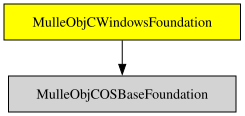

# 

#### 


## Documentation & Guides

* [API Summary](asset/dox/api/toc)


### You are here



## Add

Use [mulle-sde](//github.com/mulle-sde) to add  to your project:

``` sh
mulle-sde add :/
```

## Install

Use [mulle-sde](//github.com/mulle-sde) to build and install :

``` sh
mulle-sde install --prefix /usr/local \
   https://github.com///archive/latest.tar.gz
```

### Manual Installation

Download the latest [tar](https://github.com///archive/refs/tags/latest.tar.gz) or [zip](https://github.com///archive/refs/tags/latest.zip) archive and unpack it.

Install **** into `/usr/local` with [cmake](https://cmake.org):

``` sh
PREFIX_DIR="/usr/local"
cmake -B build                               \
      -DMULLE_SDK_PATH="${PREFIX_DIR}"       \
      -DCMAKE_INSTALL_PREFIX="${PREFIX_DIR}" \
      -DCMAKE_PREFIX_PATH="${PREFIX_DIR}"    \
      -DCMAKE_BUILD_TYPE=Release &&
cmake --build build --config Release &&
cmake --install build --config Release
```

## Author

[Nat!](https://mulle-kybernetik.com/weblog) for Mulle kybernetiK  


